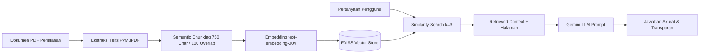

# 🌏 WanderWise AI — Smart Travel & Culinary Intelligence Platform

[](https://streamlit.io/)
[](https://aistudio.google.com/)
[](https://www.langchain.com/)
[](https://github.com/facebookresearch/faiss)
[](https://www.sqlite.org/)
[](https://groq.com/)

> **Next-Generation Travel & Culinary Intelligence Suite** bertenaga **Google Gemini**, **LangChain**, **FAISS Vector Store**, **PyMuPDF**, dan **Autonomous ReAct SQL Agent** dengan tampilan antarmuka modern berstandar SaaS.

---

## 📌 Ringkasan Produk

**WanderWise AI** adalah platform asisten perjalanan dan intelijen kuliner terintegrasi yang dirancang untuk mengatasi fragmentasi perencanaan perjalanan. Platform ini menggabungkan konsultasi berbasis persona ahli, penelusuran dokumen perjalanan privat dengan **Retrieval-Augmented Generation (RAG)**, serta analitik data pariwisata real-time berbasis **Autonomous ReAct SQL Agent**.

| Atribut | Detail Informasi |
| :--- | :--- |
| **Nama Project** | **WanderWise AI — Smart Travel & Culinary Intelligence Platform** |
| **Target Pengguna** | Wisatawan mandiri, *food enthusiast*, perencana itinerary keluarga, backpacker, digital nomad, hingga analis industri pariwisata. |
| **Nilai Tambah / Solusi** | <ul><li>Menyediakan konsultasi interaktif dengan 4 persona spesialis yang dapat disesuaikan.</li><li>Menghilangkan halusinasi jawaban dokumen melalui RAG berbasis kutipan langsung dan nomor halaman.</li><li>Menjawab pertanyaan analitis kompleks seputar destinasi, biaya, dan akomodasi langsung dari database secara otonom tanpa latensi berlebih.</li><li>Tampilan visual SaaS modern yang intuitif, responsif, dan bebas gangguan (*zero-clutter*).</li></ul> |
| **Stack Teknologi Utama** | **Streamlit**, **Google Gemini API** (`gemini-2.5-flash`), **Groq API** (`llama-3.3-70b`), **LangChain & LangGraph**, **FAISS Vector Store**, **PyMuPDF (`fitz`)**, dan **SQLite3**. |

---

## 🎨 Penyempurnaan Desain & UI/UX (SaaS Theme)

Aplikasi `app_integrated.py` dirancang dengan pendekatan visual modern layaknya produk SaaS kelas enterprise:

* **Palet Warna Emerald Teal & Ocean Blue**:
  - Warna primer: **Emerald Teal** (`#0d9488` / `#2dd4bf`) melambangkan kesegaran eksplorasi alam dan petualangan.
  - Warna sekunder: **Ocean Blue** (`#0284c7` / `#38bdf8`) mencerminkan kedalaman wawasan analitik dan laut terbuka.
  - Elemen slider, tab aktif, radio button, dan highlight tombol telah diselaraskan penuh dengan gradien aksen ini.
* **Tipografi Modern**: Menggunakan Google Font **Plus Jakarta Sans** dengan bobot tipografi presisi untuk kenyamanan membaca dalam durasi panjang.
* **Mode Chat Abu-Abu Gelap Kontras (Slate 800/900)**:
  - Pesan Asisten AI menggunakan latar **Slate 800** (`#1e293b`) bergaris tepi kiri aksen *Emerald Teal* (`#0d9488`).
  - Pesan Pengguna menggunakan latar **Slate 900** (`#0f172a`) bergaris tepi kiri aksen *Ocean Blue* (`#0284c7`).
  - Kontras teks disesuaikan secara optimal (`#e2e8f0` dan `#f8fafc`) agar tidak melelahkan mata.
* **SaaS Metric Cards Overview**: Tiga kartu ringkas metrik (*Destinasi Terkurasi*, *Knowledge Hub RAG*, dan *Autonomous SQL Agent*) di bagian atas menggantikan tampilan expander bertumpuk.
* **Status Indikator Real-time**: Indikator *Online* dengan dot pulsing hijau pada sidebar memberikan konfirmasi visual bahwa seluruh modul aktif.

---

## 🌟 Dokumentasi Fitur Utama (3 Modul Terpadu)

WanderWise AI mengintegrasikan 3 mode kecerdasan buatan utama dalam satu antarmuka mulus:

```
                          ┌─────────────────────────────────────────┐
                          │         WanderWise AI Platform          │
                          └────────────────────┬────────────────────┘
                                               │
         ┌─────────────────────────────────────┼─────────────────────────────────────┐
         ▼                                     ▼                                     ▼
  ┌──────────────┐                      ┌──────────────┐                      ┌──────────────┐
  │    MODE 1    │                      │    MODE 2    │                      │    MODE 3    │
  │ Travel Chat  │                      │ Document RAG │                      │ SQL Analyst  │
  │  & Persona   │                      │  (PDF Guide) │                      │ (ReAct Agent)│
  └──────────────┘                      └──────────────┘                      └──────────────┘
```

---

### 💬 Mode 1: Travel Chat & Persona Eksploratif

Mode ini menghadirkan pengalaman percakapan alami dengan AI yang bertindak sebagai pemandu wisata profesional sesuai kebutuhan pengguna.

#### 1. Preset Persona Khusus
Pengguna dapat memilih dari 4 preset persona atau menentukan instruksi persona sendiri:
* **Travel Expert (Destinasi & Itinerary)**: Menguasai perancangan itinerary harian, eksplorasi *hidden gems*, tips navigasi transportasi lokal, serta waktu kunjungan optimal.
* **Culinary Guide (Kuliner Lokal & Rekomendasi)**: Mengulas kuliner lokal autentik, jajanan kaki lima legendaris, filosofi rasa, serta opsi khusus vegetarian/halal.
* **Budget Travel Advisor (Hemat & Efisien)**: Spesialis penghematan anggaran, pemilihan akomodasi berbiaya rendah, transportasi publik, dan penghindaran biaya tersembunyi.
* **Cultural Historian (Sejarah & Tradisi)**: Memberikan wawasan mendalam tentang sejarah situs wisata, arsitektur, tradisi masyarakat, serta etiket sosial setempat.
* **Custom Persona**: Opsi penyesuaian instruksi sistem secara bebas sesuai preferensi pengguna.

#### 2. Prompt Suggestion Chips (Inspirasi Pertanyaan Cepat)
Disediakan tombol interaktif sekali klik untuk mengajukan pertanyaan populer:
* `🏝️ Itinerary 3 Hari di Ubud`
* `🍜 Rekomendasi Kuliner Autentik Kyoto`
* `💰 Tips Backpacker Hemat di Eropa`

#### 3. Hyperparameter Tuning & Eliminasi Cache
* **Temperature** (0.00 – 1.00): Mengontrol tingkat presisi faktual vs kreativitas ide.
* **Top-P Sampling** (0.10 – 1.00): Mengatur cakupan kumulatif pemilihan token kata.
* **Max Output Tokens** (512 – 4096, default: **2560 tokens**): Batas token ditingkatkan secara substansial guna memastikan respon rencana itinerary multi-hari yang panjang tidak terpotong di tengah kalimat.
* **Dynamic Factory Client**: Fungsi `get_llm_client()` tidak menggunakan `@st.cache_resource`, sehingga perubahan parameter di sidebar langsung aktif secara instan pada interaksi berikutnya.

---

### 📄 Mode 2: RAG Dokumen Perjalanan (PDF Knowledge Base)

Mode RAG (Retrieval-Augmented Generation) memungkinkan pengguna mengunggah dokumen pribadi (panduan wisata, e-ticket, brosur hotel, atau rencana perjalanan) dan mendapatkan jawaban yang terverifikasi dari isi dokumen tersebut.



#### Fitur Utama RAG:
* **Ekstraksi Cepat dengan PyMuPDF (`pymupdf`)**: Membaca dokumen PDF secara efisien halaman demi halaman sembari mempertahankan metadata nomor halaman.
* **Semantic Chunking**: Menggunakan `RecursiveCharacterTextSplitter` dari LangChain dengan konfigurasi `chunk_size=750` dan `chunk_overlap=100` untuk menjaga kesinambungan makna antar-paragraf.
* **Vector Store Semantik (FAISS)**: Pengindeksan vektor instan memanfaatkan model `models/text-embedding-004` dari Google Generative AI (dilengkapi fallback otomatis jika diperlukan).
* **Sampel Panduan Wisata Bawaan**: Tombol **"📖 Muat Sampel Panduan Wisata Bali"** memungkinkan pengguna langsung menguji kapabilitas RAG tanpa perlu mengunggah file manual.
* **Transparansi Bukti Rujukan (Citations & Verification)**: Panel *Retrieved Chunks* menampilkan cuplikan teks asli yang dijadikan referensi oleh AI lengkap dengan nama file sumber dan nomor halamannya, menjamin akurasi dan memitigasi risiko halusinasi.

---

### 🤖 Mode 3: AI Travel Data Analyst Agent (ReAct SQL Tool-Calling)

Mode ini mentransformasikan WanderWise AI menjadi analis data pariwisata otonom yang dapat mengonversi pertanyaan bahasa alami menjadi query SQL, mengeksekusinya ke database `wanderwise_travel.db`, dan menyajikan analisis bisnis yang mendalam.

#### 1. Arsitektur ReAct Agent Teroptimasi (Pencegahan Error 429 Rate Limit)
Pada implementasi sebelumnya, agent sering mengalami **Error 429 (Resource Exhausted / Rate Limit)** akibat melakukan pemanggilan tool (`list_tables` dan `describe_table`) berulang kali sebelum mengeksekusi query. Di `app_integrated.py`, arsitektur ini telah dioptimalkan secara signifikan:
* **Injeksi Skema Lengkap ke System Prompt**: Seluruh struktur tabel, tipe data, foreign key, dan contoh isi kolom dimasukkan langsung ke instruksi sistem agent.
* **Larangan Tool Call Berulang**: Agent diinstruksikan secara tegas untuk langsung melompat ke tool `execute_query` tanpa memanggil tool inspeksi skema.
* **Single-Turn Execution**: Memangkas siklus interaksi inferensi dari 3-4 langkah menjadi hanya 1 langkah query terarah, menghemat konsumsi token dan kuota TPM/RPM secara drastis.
* **Graceful Rate Limit Handling**: Jika kuota API Gemini tetap mencapai batas maksimum, sistem menampilkan pesan panduan yang ramah pengguna untuk menunggu jeda sejenak atau beralih model.

#### 2. Preview Database Berbasis Tab (*Tabbed View*)
Menghilangkan tampilan expander bertumpuk yang membebani layar, digantikan dengan 4 tab preview interaktif menggunakan Pandas DataFrame:
* 🌍 **Destinasi Wisata (`destinations`)**: ID, kota, negara, wilayah, musim terbaik, rata-rata budget harian (USD), rating, dan highlight wisata.
* 🏨 **Akomodasi (`accommodations`)**: Nama properti, jenis (Resort, Hostel, Villa, Hotel), tarif per malam, rating, dan fasilitas.
* 🍜 **Kuliner Lokal (`local_cuisines`)**: Nama makanan, jenis kuliner, estimasi harga, tingkat kepedasan, indikator vegetarian, dan deskripsi.
* 📋 **Booking Wisatawan (`bookings`)**: Nama traveler, tanggal check-in/out, jumlah tamu, total biaya, dan status booking (`Confirmed`, `Pending`, `Cancelled`).

#### 3. Prompt Suggestion Chips Analitik
Pengguna dapat langsung menguji analisis data kompleks melalui tombol pintasan:
* `🏷️ Destinasi Termurah`: Mencari destinasi dengan rata-rata budget harian terendah dan ratingnya.
* `🥗 Kuliner Vegetarian`: Menyaring makanan vegetarian di seluruh destinasi beserta kota dan harganya.
* `💵 Pendapatan Booking`: Menghitung agregasi pendapatan total booking yang berstatus terkonfirmasi.
* `⭐ Akomodasi Terbaik`: Menampilkan properti dengan rating tertinggi di atas 4.6 beserta tarifnya.

---

## 🚀 Panduan Instalasi & Eksekusi

### 1. Prasyarat Sistem
* **Python**: Versi 3.10 atau yang lebih baru.
* **API Key**:
  - [Google AI Studio](https://aistudio.google.com/) untuk Google Gemini *(Sangat Direkomendasikan)*.
  - [Groq Console](https://console.groq.com/) untuk Groq API *(Alternatif inference super cepat)*.

### 2. Instalasi Dependensi
Jalankan perintah berikut di terminal/PowerShell untuk menginstal seluruh pustaka yang diperlukan:

```bash
pip install streamlit langchain langchain-google-genai langchain-community langchain-text-splitters langgraph pymupdf faiss-cpu pandas langchain-groq
```

### 3. Eksekusi Aplikasi
Jalankan server aplikasi Streamlit melalui perintah:

```bash
streamlit run app_integrated.py
```

Setelah perintah dijalankan, browser Anda akan otomatis terbuka di alamat:
```text
http://localhost:8501
```

### 4. Alur Pemakaian Cepat:
1. Buka panel sidebar di sisi kiri.
2. Pilih penyedia model (**Google Gemini (Rekomendasi)** atau **Groq API**).
3. Masukkan **API Key** Anda ke dalam input yang tersedia.
4. Sesuaikan parameter (*Temperature*, *Max Tokens*) jika diinginkan.
5. Pilih salah satu dari **3 Mode Operasional** dan mulai berinteraksi!

---

## 📁 Struktur Repositori Proyek

```text
WanderWise AI/
│
├── app_integrated.py         # [Aplikasi Utama] Platform SaaS Streamlit terintegrasi
├── wanderwise_travel.db      # Database SQLite terstruktur (Destinasi, Akomodasi, Kuliner, Booking)
├── sample_store.db           # Database SQLite cadangan/pengujian
├── README.md                 # Dokumentasi komprehensif produk dan panduan penggunaan
├── .gitignore                # Aturan pengecualian berkas Git
└── .vscode/                  # Konfigurasi workspace editor
```

---

## 🔒 Keamanan & Praktik Terbaik

1. **Read-Only SQL Safety**: Fungsi `sql_execute_query` memvalidasi input query dan secara tegas hanya mengizinkan klausa `SELECT` atau `WITH`. Perintah yang berpotensi merusak data (`DROP`, `DELETE`, `UPDATE`, `INSERT`, `ALTER`) diblokir di level aplikasi.
2. **Keamanan API Key**: API Key diinputkan secara aman melalui kolom berformat password pada Streamlit session tanpa disimpan secara permanen di file kode sumber atau repository Git.
3. **Penanganan Halusinasi RAG**: Setiap jawaban yang diberikan dalam Mode 2 diwajibkan menyertakan konteks rujukan aktual dari dokumen yang terindeks.
